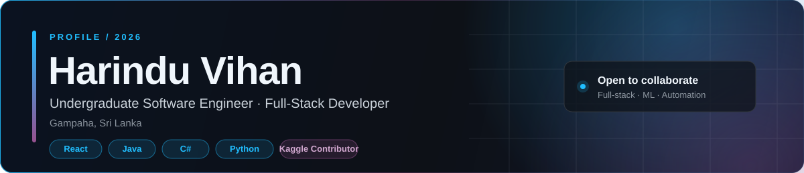
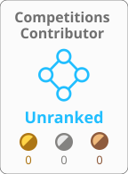

  
  

 

  

## Hi 👋! Harindu Vihan here

I’m an undergraduate software engineer at **NIBM, Sri Lanka**, building full-stack applications with React, Java, C#, and Python. I enjoy turning coursework into working products, exploring machine learning, and automating the small things that make a big difference.

**Currently:** building full-stack apps · learning Spring Boot, Docker & cloud · exploring ML

 

  <!-- Kaggle tier and medal badges — generated by .github/workflows/kaggle-badges.yml -->
  <!--  -->
  <!--  -->

## Stats

  
  

  

   <!--  -->
  

  

  

## Stack

### Frontend

  
  
  
  
  

### Backend & Data

  
  
  
  
  
  

### Tools

  
  
  

  

## Featured Projects

  
  
  

  

## Elsewhere

  
  
  
  
  

  

## Activity

  

  <!-- <h3>Stalkers</h3> -->
  

